# Strum MVP — план реализации

> **Для агентов-исполнителей:** обязательный под-навык — `superpowers:subagent-driven-development` (рекомендуется) или `superpowers:executing-plans`. Шаги размечены чекбоксами `- [ ]`.

**Цель:** Android-приложение (Capacitor) с функциональностью Strudel REPL и UI, удобным на телефоне (Pixel 9a).

**Архитектура:** Solid.js + CodeMirror 6 + пакеты `@strudel/*` внутри WebView Capacitor 8. Код является единственным источником истины: визуальные контролы переписывают литералы через acorn AST. Работа offline-first, данные хранятся в IndexedDB и Cache Storage.

**Стек (версии с npm на 2026-11-10):** `@strudel/core` 1.2.6, `mini` 1.2.6, `transpiler` 1.2.6, `tonal` 1.2.6, `draw` 1.2.6, `webaudio` 1.3.0, `soundfonts` 1.3.0, `codemirror` 1.3.0 · `@capacitor/*` 8.6.0, `@capacitor/keyboard` 8.0.6 · `solid-js` 1.9.18 · `vite` 8.3.7 · `vite-plugin-solid` 2.11.15 · `vitest` 5.1.0 · `@playwright/test` 1.65.0 · `acorn` 8.19.0 · `idb` 8.0.4 · Node 26.13 (уже есть).

**Спецификация:** [2026-11-10-strum-design.md](file:///Users/novikov.alek/projects/strum/docs/superpowers/specs/2026-11-10-strum-design.md)

## Global Constraints
- Лицензия AGPL-3.0-or-later; файлы из Weft Loom лежат в `src/vendor/weft/` с заголовком об авторстве и SHA коммита-источника `3fdda763e3c99a576b9ba92c0e58750ed135d8f7`.
- minSdk 29, target/compile SDK 36, JDK 21, applicationId `dev.strum.app`.
- Целевой viewport 412×915 dp; `user-scalable=no`; тач-цели ≥ 48 px CSS; частые действия в нижних 40% экрана.
- Код — единственный источник истины. Контролы меняют код только через `replaceLiteral` из `src/code-model/`.
- Модули: `engine/ code-model/ editor/ hints/ prebake/ storage/ ui/ vendor/`. `code-model/` и `hints/` не импортируют DOM и Strudel runtime.
- TypeScript `strict: true`. Сначала тест (TDD). Коммит после каждой задачи (Conventional Commits).
- Тёмная тема, моноширинный шрифт редактора 15 px по умолчанию.

---

## Дорожная карта

```mermaid
flowchart LR
  A["Phase A: агентский инструментарий"] --> P0["0: тулчейн + каркас + звук на устройстве"]
  P0 --> P1["1: мобильный layout + редактор"]
  P1 --> P2["2: хранилище + проекты"]
  P2 --> P3["3: prebake + шаблоны + офлайн"]
  P3 --> P4["4: подсказки"]
  P4 --> P5["5: code-model + слайдеры"]
  P5 --> P6["6: сетка + piano roll"]
  P6 --> P7["7: звуки + микшер"]
  P7 --> P8["8: визуализация + релиз"]
```



| Фаза | Результат (Definition of Done) | Детализация |
|---|---|---|
| **A** | В репозитории есть `AGENTS.md`, `.agents/skills/*` (7 навыков, доступных как slash-команды), `.agents/hooks.json`; рекомендованные плагины подключены | ниже, после ревью; навыки делаются через workflow-skill-creator |
| **0** | `s("bd sd")` звучит на эмуляторе Pixel 9a и на устройстве; `npm run check` зелёный | **полностью ниже** |
| **1** | Студия: редактор, eval/stop, подсветка, панель символов над IME, нет zoom и прыжков layout; e2e на 412×915 зелёные | **полностью ниже** |
| 2 | Репозитории IndexedDB; экран проектов; история (50 снимков); импорт/экспорт `.js`; share-ссылка и deep link strudel.cc | план пишется в начале фазы |
| 3 | `PrebakeScript`/`Template` CRUD; файл/URL/вставка; подтверждение доверия; стек проекта; кэш сэмплов; офлайн-банки | в начале фазы |
| 4 | `functionCatalog` из `doc.json`; автодополнение по контексту; справка с примером; tonal; сниппеты | в начале фазы |
| 5 | `parseBlocks/findLiterals/literalAt/replaceLiteral` с golden-тестами; слайдер-sheet на числах с hot-eval | в начале фазы |
| 6 | `miniToGrid/gridToMini`, `miniToNotes/notesToMini`; вкладка «Сетка» | в начале фазы |
| 7 | Браузер звуков с предпрослушиванием; микшер (рантайм или fallback `_$:`) | в начале фазы |
| 8 | pianoroll/punchcard; ландшафт; подписанный release APK; чек-лист на устройстве | в начале фазы |

> [!NOTE]
> Фазы 2–8 детализируются по мере продвижения. Writing-plans требует готового кода в каждом шаге, а он зависит от реальных API, которые проявятся в фазах 0–1. Расписывать их сейчас значит гадать.

---

## Целевая структура файлов (фазы 0–1)

```
strum/
├── AGENTS.md                       # правила для агентов (Phase A)
├── .agents/skills/…  .agents/hooks.json
├── package.json  tsconfig.json  vite.config.ts  vitest.config.ts  playwright.config.ts
├── capacitor.config.ts
├── index.html
├── android/                        # генерируется `cap add android`
├── src/
│   ├── main.tsx                    # mount + первый жест → initEngine
│   ├── App.tsx                     # оболочка-студия
│   ├── styles/app.css              # grid-раскладка, тема, CSS-переменные
│   ├── engine/engine.ts            # обёртка над Strudel repl
│   ├── engine/errors.ts            # нормализация ошибок (чистая функция)
│   ├── editor/Editor.tsx           # CodeMirror + strudel extensions
│   ├── editor/cursorContext.ts     # 'mini' | 'js' (чистая функция)
│   ├── ui/TopBar.tsx  ui/HintLine.tsx  ui/SymbolBar.tsx  ui/BottomNav.tsx
│   ├── ui/keyboardInset.ts         # высота IME → --kb
│   └── ui/symbols.ts               # наборы символов по контексту
└── tests/
    ├── unit/*.test.ts
    └── e2e/*.spec.ts
```

---

## Phase 0 — тулчейн, каркас, звук

### Task 0.1: Android-тулчейн

**Files:** нет (окружение). Навык: `android-cli`.

- [x] **Step 1: JDK 21**
  Run: `brew install --cask temurin@21` → `/usr/libexec/java_home -v 21`
  Expected: путь к JDK 21. Добавить в `~/.zshrc`: `export JAVA_HOME=$(/usr/libexec/java_home -v 21)`.
- [x] **Step 2: Android CLI**
  Run: `curl -fsSL https://dl.google.com/android/cli/latest/darwin_arm64/install.sh | bash` (на Intel — `darwin_x86_64`), затем `android init`.
- [x] **Step 3: SDK**
  Run: `android sdk install platforms/android-36 build-tools/36.0.0 platform-tools emulator system-images/android-36/google_apis/arm64-v8a`
  Затем `android info` → записать путь SDK в `export ANDROID_HOME=…` в `~/.zshrc`.
- [x] **Step 4: AVD**
  Run: `android emulator create --help` (уточнить флаги), создать AVD с профилем Pixel 9a (или Pixel 9, если 9a нет в списке), `android emulator start <name>`.
  Expected: `android info` показывает подключённое устройство.

### Task 0.2: Каркас Vite + Solid + TS + тесты

**Files:** Create `package.json`, `tsconfig.json`, `vite.config.ts`, `vitest.config.ts`, `index.html`, `src/main.tsx`, `src/App.tsx`, `tests/unit/smoke.test.ts`, `.gitignore`, `LICENSE` (полный текст AGPL-3.0).

**Interfaces:** Produces: npm-скрипты `dev`, `build`, `test`, `test:e2e`, `typecheck`, `check`.

- [x] **Step 1: package.json**
```json
{
  "name": "strum",
  "private": true,
  "version": "0.0.1",
  "license": "AGPL-3.0-or-later",
  "type": "module",
  "scripts": {
    "dev": "vite --host",
    "build": "vite build",
    "typecheck": "tsc --noEmit",
    "test": "vitest run",
    "test:e2e": "playwright test",
    "check": "npm run typecheck && npm run test && npm run build",
    "android": "npm run build && cap sync android && cap run android"
  }
}
```
  Run: `npm i solid-js@1.9.18 @strudel/core@1.2.6 @strudel/mini@1.2.6 @strudel/transpiler@1.2.6 @strudel/tonal@1.2.6 @strudel/draw@1.2.6 @strudel/webaudio@1.3.0 @strudel/soundfonts@1.3.0 @strudel/codemirror@1.3.0 acorn@8.19.0 idb@8.0.4`
  Run: `npm i -D typescript vite@8.3.7 vite-plugin-solid@2.11.15 vitest@5.1.0 @playwright/test@1.65.0 jsdom`
- [x] **Step 2: Конфиги**
```ts
// vite.config.ts
import { defineConfig } from 'vite'
import solid from 'vite-plugin-solid'
export default defineConfig({ plugins: [solid()], build: { target: 'es2022' }, server: { port: 5180 } })
```
```ts
// vitest.config.ts
import { defineConfig } from 'vitest/config'
export default defineConfig({ test: { include: ['tests/unit/**/*.test.ts'], environment: 'node' } })
```
```json
// tsconfig.json
{ "compilerOptions": { "target": "ES2022", "module": "ESNext", "moduleResolution": "Bundler",
  "strict": true, "jsx": "preserve", "jsxImportSource": "solid-js", "types": ["vite/client"],
  "skipLibCheck": true, "noEmit": true }, "include": ["src", "tests"] }
```
```html
<!-- index.html -->
<!doctype html>
<html lang="ru"><head><meta charset="UTF-8" />
<meta name="viewport" content="width=device-width, initial-scale=1, maximum-scale=1, user-scalable=no, viewport-fit=cover, interactive-widget=overlays-content" />
<title>Strum</title></head>
<body><div id="root"></div><script type="module" src="/src/main.tsx"></script></body></html>
```
- [x] **Step 3: Smoke-тест** `tests/unit/smoke.test.ts`
```ts
import { expect, test } from 'vitest'
test('toolchain works', () => { expect(1 + 1).toBe(2) })
```
  Run: `npm test` → PASS.
- [x] **Step 4: Минимальный App**
```tsx
// src/App.tsx
export default function App() { return <main class="app">Strum</main> }
```
```tsx
// src/main.tsx
import { render } from 'solid-js/web'
import App from './App'
render(() => <App />, document.getElementById('root')!)
```
  Run: `npm run check` → typecheck, test и build проходят.
- [x] **Step 5: Коммит** `git add -A && git commit -m "chore: scaffold vite + solid + vitest"`

### Task 0.3: Engine wrapper

**Files:** Create `src/engine/errors.ts`, `src/engine/engine.ts`, `tests/unit/errors.test.ts`.

**Interfaces — Produces:**
```ts
export type EngineError = { message: string; line: number | null }
export type EvalResult = { ok: true } | { ok: false; error: EngineError }
export interface Engine {
  evaluate(code: string): Promise<EvalResult>
  stop(): void
  setCps(cps: number): void
  readonly started: boolean
}
export function initEngine(): Promise<Engine>   // вызывать только после жеста пользователя
export function toEngineError(e: unknown): EngineError
```

- [x] **Step 1: Проверить экспорты пакетов** (защита от устаревших сведений об API)
  Run: `node -e "Promise.all(['@strudel/core','@strudel/webaudio','@strudel/transpiler','@strudel/codemirror','@strudel/draw'].map(p=>import(p).then(m=>console.log(p, Object.keys(m).filter(k=>/repl|evalScope|webaudioOutput|getAudioContext|initAudio|registerSynth|samples|transpiler|highlight|Drawer|soundMap/.test(k))))))"`
  Expected: у `repl`, `evalScope`, `webaudioOutput`, `getAudioContext`, `initAudioOnFirstClick`, `registerSynthSounds`, `samples`, `transpiler`, `highlightMiniLocations`, `Drawer` есть экспорты. Если имя отличается, поправить код ниже и записать находку в `AGENTS.md` → «Strudel API notes».
- [x] **Step 2: Падающий тест** `tests/unit/errors.test.ts`
```ts
import { expect, test } from 'vitest'
import { toEngineError } from '../../src/engine/errors'
test('extracts line from strudel/acorn error', () => {
  const e = Object.assign(new SyntaxError('Unexpected token (3:5)'), { loc: { line: 3, column: 5 } })
  expect(toEngineError(e)).toEqual({ message: 'Unexpected token (3:5)', line: 3 })
})
test('handles non-Error values', () => {
  expect(toEngineError('boom')).toEqual({ message: 'boom', line: null })
})
test('parses line from message when loc absent', () => {
  expect(toEngineError(new Error('foo (7:1)'))).toEqual({ message: 'foo (7:1)', line: 7 })
})
```
  Run: `npx vitest run tests/unit/errors.test.ts` → FAIL (модуль не найден).
- [x] **Step 3: Реализация** `src/engine/errors.ts`
```ts
export type EngineError = { message: string; line: number | null }
export function toEngineError(e: unknown): EngineError {
  if (!(e instanceof Error)) return { message: String(e), line: null }
  const loc = (e as { loc?: { line?: number } }).loc
  if (typeof loc?.line === 'number') return { message: e.message, line: loc.line }
  const m = /\((\d+):\d+\)/.exec(e.message)
  return { message: e.message, line: m ? Number(m[1]) : null }
}
```
  Run: тест → PASS.
- [x] **Step 4: `src/engine/engine.ts`** (проверяется e2e в Task 0.4)
```ts
import { repl, evalScope } from '@strudel/core'
import { transpiler } from '@strudel/transpiler'
import { getAudioContext, webaudioOutput, registerSynthSounds, samples } from '@strudel/webaudio'
import { toEngineError, type EngineError } from './errors'
export type { EngineError }
export type EvalResult = { ok: true } | { ok: false; error: EngineError }
export interface Engine { evaluate(code: string): Promise<EvalResult>; stop(): void; setCps(cps: number): void; readonly started: boolean }

let instance: Promise<Engine> | null = null
export function initEngine(): Promise<Engine> {
  return (instance ??= create())
}
async function create(): Promise<Engine> {
  const ctx = getAudioContext()
  if (ctx.state === 'suspended') await ctx.resume()
  await evalScope(import('@strudel/core'), import('@strudel/mini'), import('@strudel/tonal'), import('@strudel/webaudio'))
  await registerSynthSounds()
  // Временно: в Phase 3 заменяется стеком prebake (builtin:default)
  await samples('github:tidalcycles/dirt-samples')
  let lastError: unknown = null
  const r = repl({
    defaultOutput: webaudioOutput,
    getTime: () => getAudioContext().currentTime,
    transpiler,
    onEvalError: (e: unknown) => { lastError = e },
  })
  let started = false
  return {
    get started() { return started },
    async evaluate(code) {
      lastError = null
      try { await r.evaluate(code) } catch (e) { lastError = e }
      if (lastError) return { ok: false, error: toEngineError(lastError) }
      started = true
      return { ok: true }
    },
    stop() { r.stop(); started = false },
    setCps(cps) { r.setCps(cps) },
  }
}
```
  Run: `npm run typecheck`. Если у `@strudel/*` нет типов, добавить `src/engine/strudel.d.ts` с `declare module '@strudel/core'` и т. п. (как в Weft Loom).
- [x] **Step 5: Коммит** `feat(engine): strudel repl wrapper with error normalization`

### Task 0.4: Звук в браузере (e2e) и Capacitor

**Files:** Modify `src/App.tsx`; Create `playwright.config.ts`, `tests/e2e/engine.spec.ts`, `capacitor.config.ts`, `android/` (генерируется).

- [x] **Step 1: Playwright config**
```ts
import { defineConfig, devices } from '@playwright/test'
export default defineConfig({
  testDir: 'tests/e2e',
  use: { ...devices['Pixel 7'], viewport: { width: 412, height: 915 }, baseURL: 'http://localhost:5180',
         launchOptions: { args: ['--autoplay-policy=no-user-gesture-required'] } },
  webServer: { command: 'npm run dev', port: 5180, reuseExistingServer: true },
})
```
  Run: `npx playwright install chromium`
- [x] **Step 2: Падающий e2e** `tests/e2e/engine.spec.ts`
```ts
import { test, expect } from '@playwright/test'
test('play button evaluates a pattern without error', async ({ page }) => {
  await page.goto('/')
  await page.getByRole('button', { name: 'Play' }).tap()
  await expect(page.getByTestId('engine-status')).toHaveText('playing', { timeout: 20_000 })
})
```
  Run: `npx playwright test tests/e2e/engine.spec.ts` → FAIL.
- [x] **Step 3: App с кнопкой Play**
```tsx
import { createSignal } from 'solid-js'
import { initEngine } from './engine/engine'
export default function App() {
  const [status, setStatus] = createSignal<'idle' | 'loading' | 'playing' | 'error'>('idle')
  const play = async () => {
    setStatus('loading')
    const engine = await initEngine()
    const r = await engine.evaluate('s("bd sd")')
    setStatus(r.ok ? 'playing' : 'error')
  }
  return <main class="app">
    <button aria-label="Play" onClick={play}>▶</button>
    <span data-testid="engine-status">{status()}</span>
  </main>
}
```
  Run: e2e → PASS. (Первая загрузка сэмплов идёт из сети; в Phase 3 появится кэш.)
- [x] **Step 4: Capacitor**
  Run: `npm i @capacitor/core@8.6.0 @capacitor/android@8.6.0 @capacitor/keyboard@8.0.6 && npm i -D @capacitor/cli@8.6.0`
```ts
// capacitor.config.ts
import type { CapacitorConfig } from '@capacitor/cli'
const config: CapacitorConfig = {
  appId: 'dev.strum.app', appName: 'Strum', webDir: 'dist',
  android: { minWebViewVersion: 120 },
  plugins: { Keyboard: { resize: 'none' } },
}
export default config
```
  Run: `npm run build && npx cap add android`
  Modify `android/variables.gradle`: `minSdkVersion = 29`, `compileSdkVersion = 36`, `targetSdkVersion = 36`.
- [x] **Step 5: Запуск на эмуляторе**
  Run: `npx cap run android` (или `android run --apks=android/app/build/outputs/apk/debug/app-debug.apk`).
  Проверка: тап по ▶ → слышна бочка/малый; `android screen capture -o tmp/p0.png` показывает `playing`.
- [x] **Step 6: Коммит** `feat: capacitor android shell plays first pattern`

---

## Phase 1 — мобильная студия

### Task 1.1: Оболочка layout

**Files:** Create `src/styles/app.css`, `src/ui/TopBar.tsx`, `src/ui/HintLine.tsx`, `src/ui/BottomNav.tsx`; Modify `src/App.tsx`; Test `tests/e2e/layout.spec.ts`.

**Interfaces — Produces:** `type Tab = 'code' | 'grid' | 'sounds' | 'mix'`; `BottomNav(props: { tab: Tab; onTab(t: Tab): void })`; CSS-переменная `--kb` (высота клавиатуры в px).

- [x] **Step 1: Падающий e2e**
```ts
import { test, expect } from '@playwright/test'
test('studio fits 412x915 without scroll and thumb controls are at bottom', async ({ page }) => {
  await page.goto('/')
  const doc = await page.evaluate(() => ({ sw: document.documentElement.scrollWidth, sh: document.documentElement.scrollHeight }))
  expect(doc.sw).toBeLessThanOrEqual(412); expect(doc.sh).toBeLessThanOrEqual(915)
  const nav = await page.getByRole('navigation').boundingBox()
  expect(nav!.y + nav!.height).toBeGreaterThan(915 - 2)
  for (const name of ['Код', 'Сетка', 'Звуки', 'Микс']) {
    const b = await page.getByRole('tab', { name }).boundingBox()
    expect(b!.height).toBeGreaterThanOrEqual(48)
  }
  const meta = await page.locator('meta[name=viewport]').getAttribute('content')
  expect(meta).toContain('user-scalable=no')
})
```
- [x] **Step 2: CSS** `src/styles/app.css`
```css
:root { --kb: 0px; --bg: #0e0f12; --fg: #e8e6e3; --accent: #7cf0b0; --muted: #8a8f98;
        color-scheme: dark; font-family: system-ui, sans-serif; }
html, body, #root { height: 100%; margin: 0; background: var(--bg); color: var(--fg);
        overflow: hidden; overscroll-behavior: none; touch-action: manipulation;
        -webkit-text-size-adjust: 100%; text-size-adjust: 100%; }
.app { display: grid; height: calc(100dvh - var(--kb));
       grid-template-rows: 48px minmax(0, 1fr) auto auto 56px;
       padding: env(safe-area-inset-top) env(safe-area-inset-right) env(safe-area-inset-bottom) env(safe-area-inset-left);
       box-sizing: border-box; }
.app.kb-open { grid-template-rows: 48px minmax(0, 1fr) auto auto 0; } /* nav скрыт при открытой IME */
.topbar, .bottomnav { display: flex; align-items: stretch; }
.bottomnav [role=tab] { flex: 1; min-height: 48px; background: none; border: 0; color: var(--muted); font-size: 14px; }
.bottomnav [role=tab][aria-selected=true] { color: var(--accent); }
.topbar button { min-width: 48px; min-height: 48px; }
```
- [x] **Step 3: Компоненты** (каждый — небольшой Solid-компонент; `BottomNav` рендерит `<nav><div role="tablist">` с четырьмя `<button role="tab" aria-selected>`). `App` собирает: `TopBar` (Play/Stop, `engine-status`, BPM, ⋮) → область вкладки → `HintLine` → `SymbolBar` (заглушка до 1.3) → `BottomNav`.
- [x] **Step 4:** e2e → PASS; `npm run check` → PASS.
- [x] **Step 5: Коммит** `feat(ui): mobile studio shell layout`

### Task 1.2: Редактор + eval + ошибки

**Files:** Create `src/editor/Editor.tsx`; Modify `src/App.tsx`, `src/ui/HintLine.tsx`; Test `tests/e2e/editor.spec.ts`.

**Interfaces — Produces:** `Editor(props: { initial: string; onReady(api: EditorApi): void })`, где
`EditorApi = { getCode(): string; setCode(c: string): void; insert(text: string, cursorOffset?: number): void; cursor(): number; markError(line: number | null): void; view: EditorView }`.

- [x] **Step 1: Падающий e2e**
```ts
test('eval error keeps previous pattern and shows message', async ({ page }) => {
  await page.goto('/')
  await page.getByRole('button', { name: 'Play' }).tap()
  await expect(page.getByTestId('engine-status')).toHaveText('playing', { timeout: 20_000 })
  await page.locator('.cm-content').tap()
  await page.keyboard.press('ControlOrMeta+a'); await page.keyboard.type('s("bd sd"')
  await page.getByRole('button', { name: 'Eval' }).tap()
  await expect(page.getByTestId('hint-line')).toContainText(/Unexpected|expected/i)
  await expect(page.getByTestId('engine-status')).toHaveText('playing')
})
```
- [x] **Step 2: Editor.tsx**: `EditorView` из `@codemirror/view` с расширениями `basicSetup`-подмножество (history, drawSelection, highlightActiveLine, bracketMatching, `javascript()` из `@codemirror/lang-javascript`), `EditorView.lineWrapping`, тема (fontSize 15px, тёмный фон), плюс подсветка mini-notation из `@strudel/codemirror`, если она экспортируется отдельно (проверить ключи модуля, как в 0.3 Step 1). Ошибочная строка помечается `Decoration.line({ class: 'cm-error-line' })` через `StateField`.
  Run: `npm i @codemirror/view @codemirror/state @codemirror/commands @codemirror/language @codemirror/lang-javascript`
- [x] **Step 3:** кнопка `Eval` в TopBar вызывает `engine.evaluate(api.getCode())`. При `ok:false` вызывается `api.markError(line)`, а `HintLine` показывает `error.message`; статус не меняется.
- [x] **Step 4:** e2e → PASS. **Step 5: Коммит** `feat(editor): codemirror editor with eval and error marking`

### Task 1.3: Контекст курсора + панель символов

**Files:** Create `src/editor/cursorContext.ts`, `src/ui/symbols.ts`, `src/ui/SymbolBar.tsx`; Test `tests/unit/cursorContext.test.ts`, `tests/e2e/symbolbar.spec.ts`.

**Interfaces — Produces:** `cursorContext(code: string, pos: number): 'mini' | 'js'`; `symbolsFor(ctx): string[]`.

- [x] **Step 1: Падающие unit-тесты**
```ts
import { expect, test } from 'vitest'
import { cursorContext as c } from '../../src/editor/cursorContext'
test('inside double quotes is mini', () => expect(c('s("bd ', 6)).toBe('mini'))
test('inside backticks is mini', () => expect(c('s(`bd\nsd', 8)).toBe('mini'))
test('single quotes are plain js strings', () => expect(c("samples('gith", 13)).toBe('js'))
test('after closing quote is js', () => expect(c('s("bd").', 8)).toBe('js'))
test('escaped quote stays in string', () => expect(c('s("a\\"b ', 8)).toBe('mini'))
test('line comment is js', () => expect(c('// "x', 5)).toBe('js'))
```
- [x] **Step 2: Реализация**
```ts
export type CursorCtx = 'mini' | 'js'
export function cursorContext(code: string, pos: number): CursorCtx {
  let q: '"' | '`' | "'" | null = null
  let lineComment = false, blockComment = false
  for (let i = 0; i < pos; i++) {
    const ch = code[i], nx = code[i + 1]
    if (lineComment) { if (ch === '\n') lineComment = false; continue }
    if (blockComment) { if (ch === '*' && nx === '/') { blockComment = false; i++ } continue }
    if (q) { if (ch === '\\') { i++; continue } if (ch === q) q = null; continue }
    if (ch === '/' && nx === '/') { lineComment = true; i++; continue }
    if (ch === '/' && nx === '*') { blockComment = true; i++; continue }
    if (ch === '"' || ch === '`' || ch === "'") q = ch
  }
  return q === '"' || q === '`' ? 'mini' : 'js'
}
```
- [x] **Step 3: `symbols.ts`**
```ts
import type { CursorCtx } from '../editor/cursorContext'
const MINI = ['~', '*', '/', '[', ']', '<', '>', ',', '?', '!', '@', ':', '.', '|', '(', ')']
const JS = ['$:', '"', '.', '(', ')', '[', ']', ',', '=>', 'n(', 's(', 'note(', '.bank(', '.fast(', '.slow(', '.lpf(', '.gain(', '.room(']
export const symbolsFor = (c: CursorCtx) => (c === 'mini' ? MINI : JS)
```
- [x] **Step 4: SymbolBar**: два горизонтально прокручиваемых ряда кнопок высотой ≥ 48 px. `onPointerDown` вызывает `preventDefault()`, чтобы фокус редактора и IME не терялись. Вставка через `api.insert(sym, sym.endsWith('(') ? 0 : undefined)` с автозакрытием `(` → `()`, курсор ставится внутрь. Кнопки `⇥` (Tab на 2 пробела) и `⌫`. Контекст пересчитывается по `EditorView.updateListener`.
- [x] **Step 5: e2e**: тап по редактору внутри `"…"` показывает `~`; вне строки показывает `$:`; тап по `~` вставляет символ, фокус остаётся на `.cm-content`.
- [x] **Step 6:** unit и e2e → PASS. **Коммит** `feat(ui): context-aware symbol bar`

### Task 1.4: Подсветка играющих событий

**Files:** Modify `src/engine/engine.ts` (добавить `onHighlight`), `src/editor/Editor.tsx`; Test `tests/e2e/highlight.spec.ts`.

**Interfaces — Produces:** `Engine.onHighlight(cb: (haps: unknown[], time: number) => void): () => void`.

- [x] **Step 1: Падающий e2e**: после Play в течение 3 с появляется хотя бы один элемент `.cm-content [class*=strudel]` или `.cm-hap-active` (точный класс взять из `highlightMiniLocations`).
- [x] **Step 2:** в `engine.ts` создаётся `new Drawer((haps, time) => listeners.forEach(l => l(haps, time)), [0, 0])` из `@strudel/draw`. `drawer.start(r.scheduler)` вызывается после успешного eval, `drawer.invalidate(r.scheduler)` — после каждого eval, `drawer.stop()` — в `stop()`. Сигнатуру сверить с исходником `@strudel/codemirror` (`StrudelMirror`) в `node_modules`.
- [x] **Step 3:** Editor подписывается и вызывает `highlightMiniLocations(view, time, haps)`. Расширение `@strudel/codemirror` для подсветки подключается в Editor.
- [x] **Step 4:** e2e → PASS. **Коммит** `feat(editor): highlight active haps`

### Task 1.5: Клавиатура (IME) без прыжков layout

**Files:** Create `src/ui/keyboardInset.ts`; Modify `src/main.tsx`, `src/App.tsx`; Test `tests/unit/keyboardInset.test.ts`.

**Interfaces — Produces:** `computeInset(layoutHeight: number, visualHeight: number, offsetTop: number): number`; `installKeyboardInset(root: HTMLElement): () => void`.

- [x] **Step 1: Падающий unit-тест**
```ts
import { expect, test } from 'vitest'
import { computeInset } from '../../src/ui/keyboardInset'
test('no keyboard', () => expect(computeInset(915, 915, 0)).toBe(0))
test('keyboard 320px', () => expect(computeInset(915, 595, 0)).toBe(320))
test('ignores tiny diffs (url bar jitter)', () => expect(computeInset(915, 900, 0)).toBe(0))
```
- [x] **Step 2: Реализация**
```ts
import { Capacitor } from '@capacitor/core'
import { Keyboard } from '@capacitor/keyboard'
export function computeInset(layoutH: number, visualH: number, offsetTop: number): number {
  const d = Math.round(layoutH - visualH - offsetTop)
  return d > 80 ? d : 0
}
export function installKeyboardInset(root: HTMLElement): () => void {
  const apply = (px: number) => { root.style.setProperty('--kb', `${px}px`); root.classList.toggle('kb-open', px > 0) }
  if (Capacitor.isNativePlatform()) {
    const subs = [
      Keyboard.addListener('keyboardWillShow', (i) => apply(i.keyboardHeight)),
      Keyboard.addListener('keyboardWillHide', () => apply(0)),
    ]
    return () => subs.forEach((s) => s.then((h) => h.remove()))
  }
  const vv = window.visualViewport
  if (!vv) return () => {}
  const on = () => apply(computeInset(window.innerHeight, vv.height, vv.offsetTop))
  vv.addEventListener('resize', on); return () => vv.removeEventListener('resize', on)
}
```
  Примечание: на Android `keyboardHeight` приходит в dp/CSS px. Проверить на устройстве и при необходимости разделить на `devicePixelRatio`.
- [x] **Step 3:** `installKeyboardInset(document.querySelector('.app')!)` в `App` через `onMount`.
- [x] **Step 4: Ручная проверка на эмуляторе/устройстве** (`npm run android`): при открытии IME панель символов прилипает к клавиатуре, верхняя панель на месте, pinch не масштабирует, нижняя навигация скрыта. Скриншот: `android screen capture -o tmp/p1-ime.png`. Если `env(safe-area-inset-*)` равен 0 при edge-to-edge (Android 15+), добавить отступы через Capacitor `SystemBars`/insets и записать решение в `AGENTS.md`.
- [x] **Step 5: Коммит** `feat(ui): keyboard inset handling for IME`

### Task 1.6: Темп и hush

**Files:** Modify `src/ui/TopBar.tsx`, `src/App.tsx`; Create `src/ui/tempo.ts`; Test `tests/unit/tempo.test.ts`.

**Interfaces — Produces:** `bpmToCps(bpm: number, beatsPerCycle = 4): number`, `cpsToBpm(cps: number, beatsPerCycle = 4): number`.

- [x] **Step 1: Тест**
```ts
import { expect, test } from 'vitest'
import { bpmToCps, cpsToBpm } from '../../src/ui/tempo'
test('120 bpm in 4/4 = 0.5 cps', () => expect(bpmToCps(120)).toBe(0.5))
test('roundtrip', () => expect(cpsToBpm(bpmToCps(97))).toBeCloseTo(97))
```
- [x] **Step 2:** `export const bpmToCps = (b: number, n = 4) => b / 60 / n; export const cpsToBpm = (c: number, n = 4) => c * 60 * n`
- [x] **Step 3:** тап по BPM открывает простой bottom-sheet со слайдером 40–200 (полноценный sheet появится в Phase 5) → `engine.setCps`. Свайп вниз по TopBar (`pointerdown`→`pointermove` dy > 60) вызывает `engine.stop()` (hush).
- [x] **Step 4:** `npm run check && npm run test:e2e` → PASS. **Коммит** `feat(ui): tempo control and hush gesture`

**Финал Phase 1:** проверено на устройстве и эмуляторе Pixel 9a AVD.

---

## Phase 2 — хранилище, проекты, история версий

### Task 2.1: База данных IndexedDB и репозитории (`src/storage/`)
**Files:** Create `src/storage/db.ts`, `src/storage/projectRepo.ts`, `src/storage/versionRepo.ts`; Test `tests/unit/storage.test.ts`.

**Interfaces — Produces:**
- `initDb(): Promise<IDBPDatabase<StrumDB>>`
- `projectRepo`: `getAll()`, `get(id)`, `create(data)`, `update(id, data)`, `delete(id)`
- `versionRepo`: `getForProject(projectId)`, `snapshot(projectId, code, note?)`, `restore(versionId)`

- [x] **Step 1: fake-indexeddb** devDependency и падающий unit-тест `tests/unit/storage.test.ts`.
- [x] **Step 2:** Реализация схемы `strum_db` (v1) с хранилищами `projects` (key: `id`, index: `updatedAt`), `versions` (key: `id`, index: `projectId`, `createdAt`), `settings`.
- [x] **Step 3:** CRUD-методы `projectRepo` и `versionRepo` с авто-ротацией снимков (максимум 50 версий на проект).
- [x] **Step 4:** Unit-тесты → PASS. **Коммит** `feat(storage): indexeddb schema and project/version repositories`.

### Task 2.2: Автоснимки версий и история изменений
**Files:** Modify `src/App.tsx`, `src/engine/engine.ts`; Create `src/ui/VersionHistorySheet.tsx`; Test `tests/unit/versionHistory.test.ts`, `tests/e2e/versions.spec.ts`.

- [x] **Step 1:** Автоматическое сохранение снимка в `versionRepo` при каждом успешном `evaluate` (дебаунс 2 секунды от одинакового кода).
- [x] **Step 2:** Sheet истории версий: список последних снимков с временной меткой, превью первых строк кода, кнопка «Откатить к этой версии».
- [x] **Step 3:** E2E тест: успешный eval создаёт запись в истории, выбор предыдущей версии восстанавливает код в редактор.
- [x] **Step 4:** Тесты → PASS. **Коммит** `feat(history): automatic version snapshots and restore sheet`.

### Task 2.3: Экран и менеджер проектов (`ProjectsModal` / `ProjectsScreen`)
**Files:** Create `src/ui/ProjectsScreen.tsx`; Modify `src/App.tsx`, `src/ui/TopBar.tsx`; Test `tests/e2e/projects.spec.ts`.

- [x] **Step 1:** Кнопка меню ⋮ в `TopBar` открывает список проектов.
- [x] **Step 2:** Карточки проектов: имя, дата обновления, количество строк, кнопки «Открыть», «Переименовать», «Дублировать», «Удалить». Кнопка «+ Новый проект».
- [x] **Step 3:** Переключение текущего проекта сохраняет код предыдущего и загружает код выбранного.
- [x] **Step 4:** E2E тест управления проектами. **Коммит** `feat(ui): project manager screen with create/switch/delete`.

### Task 2.4: Импорт, экспорт и strudel.cc deep links
**Files:** Create `src/storage/shareUrl.ts`; Modify `src/ui/TopBar.tsx`, `src/App.tsx`; Test `tests/unit/shareUrl.test.ts`, `tests/e2e/share.spec.ts`.

- [x] **Step 1:** `encodeStrudelUrl(code: string): string` (`https://strudel.cc/#<base64>`) и `decodeStrudelUrl(urlOrHash: string): string | null`.
- [x] **Step 2:** Экспорт кода в файл `.js` и копирование share-ссылки в буфер обмена.
- [x] **Step 3:** При запуске с `#...` в URL (или intent deep link) — импорт паттерна в новый проект.
- [x] **Step 4:** Тесты → PASS. **Коммит** `feat(storage): file export and strudel share links`.

---

## Phase 3 — prebake-скрипты, шаблоны проектов и офлайн

### Task 3.1: PrebakeScript и Template репозитории (`src/storage/`)
**Files:** Modify `src/storage/db.ts`; Create `src/storage/prebakeRepo.ts`, `src/storage/templateRepo.ts`; Test `tests/unit/prebakeRepo.test.ts`, `tests/unit/templateRepo.test.ts`.

- [x] **Step 1:** Миграция схемы `strum_db` до версии 2 с хранилищами `prebakes` и `templates`.
- [x] **Step 2:** Репозиторий `prebakeRepo`: встроенный `builtin:default`, создание, обновление, сброс `trusted: false` при обновлении URL.
- [x] **Step 3:** Репозиторий `templateRepo`: упаковка и распаковка портативных бандлов шаблонов JSON (`schemaVersion: 1`).
- [x] **Step 4:** Unit-тесты → PASS. **Коммит** `feat(storage): prebake and template repositories with bundle packing`.

### Task 3.2: Раннер prebake-скриптов с изоляцией ошибок
**Files:** Create `src/prebake/runner.ts`; Modify `src/engine/engine.ts`; Test `tests/unit/prebakeRunner.test.ts`.

- [x] **Step 1:** `runPrebake(scripts, evalFn): Promise<PrebakeReport>` с последовательным исполнением в REPL.
- [x] **Step 2:** Проверка безопасности `trusted: boolean`: непроверенные скрипты пропускаются (`skippedReason: 'untrusted'`).
- [x] **Step 3:** Изоляция ошибок в `PrebakeReport`: падение одного скрипта не блокирует последующие и пользовательский код.
- [x] **Step 4:** Unit-тесты → PASS. **Коммит** `feat(prebake): runner with trust enforcement and error isolation`.

### Task 3.3: Управление prebake-скриптами и шаблонами в UI
**Files:** Create `src/ui/PrebakeSheet.tsx`, `src/ui/TemplatesSheet.tsx`; Modify `src/App.tsx`; Test `tests/e2e/prebake.spec.ts`.

- [x] **Step 1:** Шторка `PrebakeSheet`: список скриптов, переключение в стеке проекта, добавление скрипта по URL или кодом, кнопка подтверждения доверия.
- [x] **Step 2:** Шторка `TemplatesSheet`: создание нового проекта из шаблона, экспорт и импорт JSON-бандлов шаблона.
- [x] **Step 3:** Пункты в TopBar меню и сохранение текущего стека в проект.
- [x] **Step 4:** E2E тест → PASS. **Коммит** `feat(prebake): ui sheets for prebake stack, templates and sample cache`.

### Task 3.4: Офлайн-кэш сэмплов
**Files:** Create `src/storage/sampleCache.ts`; Test `tests/unit/sampleCache.test.ts`.

- [x] **Step 1:** Обёртка над Cache Storage API (`caches.open('strum-samples-v1')`).
- [x] **Step 2:** Проверка кэширования, добавление URL в кэш и очистка с безопасным fallback в окружениях без `caches`.
- [x] **Step 3:** Unit-тест → PASS.

---

## Phase A — агентский инструментарий (после одобрения плана)

Создаётся через **workflow-skill-creator** (короткий раунд уточнений → дизайн навыков → реализация → валидация). Всё хранится в репозитории (`.agents/`), чтобы агенты получали это автоматически.

### A.1 Правила: `AGENTS.md` (корень)
Global Constraints из этого плана; карта модулей и их границы; команды (`npm run check`, `test:e2e`, `android`); правило «контролы → только `replaceLiteral`»; порядок вендоринга Weft Loom; раздел «Strudel API notes» (пополняется находками); процесс: spec → plan → subagent-driven-development, TDD, коммит на задачу.

### A.2 Навыки (каждый вызывается и как `/имя`)
| Навык | Назначение | Скрипт |
|---|---|---|
| `strum-check` | Полная проверка: typecheck, unit, build, опционально e2e; разбор упавших тестов | `scripts/check.py` |
| `strum-android` | Тулчейн (JDK/SDK/AVD), `build → cap sync → run`, скриншот, logcat WebView, отладка через `chrome://inspect` | `scripts/android_tool.py {doctor\|run\|shot\|logcat}`; ссылается на `android-cli`, `android-device-hub` |
| `strum-mobile-ui-audit` | Аудит экрана 412×915: тач-цели ≥ 48, зона большого пальца, нет scroll/zoom, контраст; скриншоты Playwright | `scripts/ui_audit.py`; ссылается на `a11y-debugging`, `chrome-devtools` |
| `strudel-reference` | Справка по API Strudel и mini-notation: поиск функции в `doc.json`, примеры, правила prebake / `samples()` / `strudel.json` | `scripts/strudel_docs.py {fn\|search\|mini}` (офлайн-индекс `doc.json` + GitHub fallback с rate limit) |
| `strum-code-model` | Процедура добавления нового двунаправленного контрола: golden-тесты, инвариант «вне литерала без изменений», fallback «только код» | — (инструкции + шаблон теста) |
| `strum-weft-vendor` | Перенос модуля из Weft Loom: заголовок AGPL и авторства, pin SHA, адаптация импортов, запись в `src/vendor/weft/README.md` | `scripts/vendor.py <path> --sha <sha> --output <file>` |
| `strum-prebake-author` | Помощник по созданию, проверке и упаковке пользовательских prebake-скриптов (`samples()`, `register()`, `aliasBank()`) и JSON-шаблонов проектов | `scripts/prebake_tool.py {validate\|pack-template\|inspect}` |

### A.3 Hooks: `.agents/hooks.json`
- `SessionStart` — добавляет в контекст текущую фазу и первые незакрытые чекбоксы активного плана из `docs/superpowers/plans/`.
- `PreToolUse` (`run_command`) — запрещает `git push --force` и `rm -rf` вне `dist/`, `tmp/`, `android/app/build`.

### A.4 Плагины
- Уже установлены и используются: **Android CLI**, **Chrome DevTools**, **Superpowers**, **Modern Web Guidance** (без Context7).

---

## Принятые решения (Resolved Questions)

1. **Где хранить навыки:** локально в репозитории `.agents/skills/` (версионируются в git вместе с проектом).
2. **Hooks из A.3:** включены оба (`SessionStart` и `PreToolUse`).
3. **Набор навыков A.2:** все 7 навыков (`strum-check`, `strum-android`, `strum-mobile-ui-audit`, `strudel-reference`, `strum-code-model`, `strum-weft-vendor`, `strum-prebake-author`).
4. **Устройство:** сначала эмулятор Pixel 9a (AVD), физическое устройство подключается позже.

> [!WARNING]
> Phase 0 устанавливает на машину JDK 21 (Homebrew), Android CLI и SDK (~3–5 ГБ). Для этих команд нужен доступ к сети вне песочницы, и каждая потребует подтверждения.

## Verification Plan

### Automated Tests
- `npm run check` — typecheck, Vitest, build (после каждой задачи).
- `npm run test:e2e` — Playwright, Chromium, 412×915, touch (после задач с UI).

### Manual Verification
- `npm run android` на эмуляторе Pixel 9a и, если есть, на устройстве: звук, подсветка, IME и панель символов, нет pinch-zoom, back-кнопка, safe-area.
- Скриншоты через `android screen capture` прикладываются к walkthrough.
