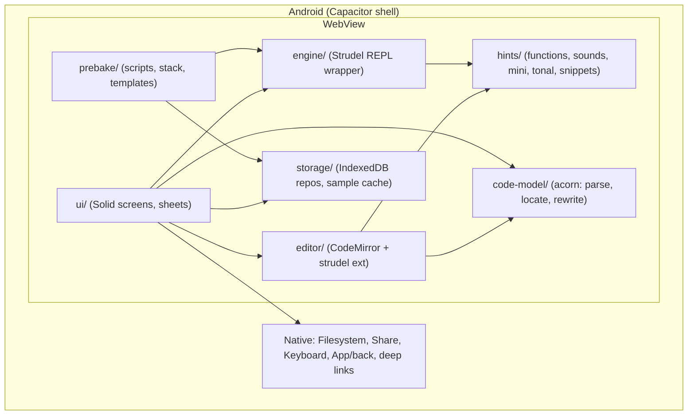

# Strum — мобильный Android-клиент для Strudel (дизайн)

- **Дата:** 2026-11-10
- **Статус:** утверждён по секциям, ожидает ревью спецификации
- **Лицензия проекта:** AGPL-3.0-or-later (как Strudel и Weft Loom)
- **Целевое устройство:** Google Pixel 9a (портрет 412×915 dp), minSdk 29 (Android 10)

## 1. Проблема и цель

strudel.cc — это PWA, рассчитанная на большие экраны. На телефоне масштаб «плавает» (pinch-zoom, прыжки при открытии клавиатуры), панели тесные, набирать mini-notation на системной клавиатуре неудобно.

**Цель:** Android-приложение с функциональностью Strudel REPL, в котором UI спроектирован под телефон. В приложении есть подсказки по функциям, паттернам, инструментам и сэмплам, визуальные контролы, синхронизированные с кодом, пользовательские prebake-скрипты и шаблоны на их основе.

**Не цели (MVP):** экспорт и запись WAV, фоновое воспроизведение при выключенном экране, MIDI, совместные джемы, Hydra-визуалы, публикация в облако. Всё это — кандидаты в фазы после MVP.

## 2. Принципы

1. **Код — единственный источник истины.** Визуальные контролы (сетка, piano roll, слайдеры) читают код через AST и переписывают литералы. Своего состояния они не хранят. Код всегда совместим со strudel.cc.
2. **Фиксированный масштаб.** Pinch-zoom запрещён (`user-scalable=no`). Размер шрифта задаётся только настройкой редактора.
3. **Offline-first.** Движок и UI находятся в APK, сэмплы кэшируются после первого обращения.
4. **Зона большого пальца.** Частые действия расположены в нижних 40% экрана, тач-цели не меньше 48 dp.
5. **Изолированные модули** с явными интерфейсами. Каждый модуль тестируется отдельно.

## 3. Стек

| Слой | Технология |
|---|---|
| Оболочка | Capacitor 7 (Android), плагины: Filesystem, Share, App, StatusBar, Keyboard, `@capacitor-community/keep-awake` |
| UI | Solid.js + Vite + TypeScript (strict) |
| Редактор | CodeMirror 6 + `@strudel/codemirror` |
| Движок | `@strudel/core`, `mini`, `transpiler`, `webaudio`, `tonal`, `soundfonts`, `draw` (версии фиксируются при Phase 0) |
| Разбор кода | acorn (+ acorn-walk) |
| Хранилище | IndexedDB через `idb`; сэмплы в Cache Storage |
| Тесты | Vitest (+ fake-indexeddb, jsdom по необходимости), Playwright (Chromium, viewport 412×915) |

**Заимствование из Weft Loom** (`github.com/alaca/weft-loom`, AGPL-3.0-or-later): отдельные модули копируются в `src/vendor/weft/` с заголовком об авторстве и ссылкой на коммит. Кандидаты: `src/engine/prebake.ts` (регистрация звуков), `src/controls/catalog.ts` (диапазоны параметров). Весь проект не форкается.

## 4. Архитектура



### 4.1 Модули и интерфейсы

- **`engine/`** — обёртка над Strudel REPL.
  - `initEngine(): Promise<Engine>` — инициализирует AudioContext (`latencyHint: 'interactive'`) после первого жеста пользователя.
  - `Engine.evaluate(code: string): Promise<EvalResult>`, где `EvalResult = { ok: true } | { ok: false, error: EngineError }`.
  - `Engine.stop()`, `Engine.setCps(cps: number)`, `Engine.onHighlight(cb: (locs: Range[]) => void)`.
  - `Engine.runPrebake(scripts: PrebakeScript[]): Promise<PrebakeReport>`.
  - `Engine.listSounds(): SoundInfo[]` — снимок `soundMap`.
  - `Engine.setBlockMix(index: number, mix: { gain: number; muted: boolean; solo: boolean })` — микшер в рантайме, код не меняется.
- **`code-model/`** — чистые функции без DOM.
  - `parseBlocks(code): Block[]` — блоки `$:` и их диапазоны.
  - `findLiterals(code): Literal[]` — `{ kind: 'number' | 'mini', range: [from, to], value, callee: string, blockIndex }`.
  - `literalAt(code, pos): Literal | null`.
  - `replaceLiteral(code, literal, newText): string`. Гарантия: меняется только диапазон литерала.
  - `miniToGrid(mini: string): Grid | null` → `{ steps: (string | null)[] }`, где `null` означает паузу. Для нерепрезентабельной нотации возвращает `null`.
  - `gridToMini(grid: Grid): string`.
  - `miniToNotes(mini): NoteEvent[] | null`, `notesToMini(notes): string`.
- **`hints/`**
  - `functionCatalog`: загружается из `doc.json` Strudel (вшит в сборку): `{ name, signature, description, examples[] }`.
  - `soundIndex(sounds: SoundInfo[])`: поиск по имени, банку и типу (sample, synth, soundfont).
  - `miniHelp`: описание символов mini-notation.
  - `tonalHints`: ноты, лады, аккорды из `@strudel/tonal`.
  - `snippets`: встроенные и пользовательские.
  - `completionSource(ctx)`: CodeMirror-источник, выбирает каталог по контексту (после `.`, внутри `s("…")`/`.bank("…")`, внутри `note("…")`/`.scale("…")`).
- **`prebake/`** — управление скриптами, стеком проекта и шаблонами (см. §6).
- **`storage/`** — репозитории `projects`, `versions`, `prebakes`, `templates`, `snippets`, `settings`, плюс `sampleCache` (Cache Storage, перехват fetch для URL сэмплов).
- **`editor/`** — конфигурация CodeMirror: тема, подсветка активных событий, обработка тапов по литералам (открывает соответствующий sheet), панель символов.
- **`ui/`** — экраны и bottom sheets (см. §5).

## 5. UI

### 5.1 Студия (портрет)

```
┌──────────────────────────────┐
│ ▶/■  120bpm  ⟳eval  ⋮       │ верхняя панель 48dp
├──────────────────────────────┤
│ редактор (CodeMirror)        │ моноширинный 15sp, перенос строк,
│                              │ подсветка играющих событий
├──────────────────────────────┤
│ строка подсказки             │ сигнатура/описание
├──────────────────────────────┤
│ панель символов (2 ряда)     │ контекстные символы + сниппеты
├──────────────────────────────┤
│  Код │ Сетка │ Звуки │ Микс  │ нижняя навигация
└──────────────────────────────┘
```

- **Вкладки:** `Код` (редактор), `Сетка` (степ-сетка или piano roll паттерна под курсором), `Звуки` (браузер сэмплов с предпрослушиванием и вставкой), `Микс` (полосы по блокам `$:`: mute, solo, gain).
- **Bottom sheets:** тап по числу открывает слайдер (диапазон из каталога параметров, лог-шкала для частот, hot-eval с дебаунсом 100 мс); тап по `s("…")` открывает пикер сэмплов; тап по mini-строке открывает сетку.
- **Клавиатура:** панель символов закреплена над IME (Capacitor Keyboard + `visualViewport`), редактор не прыгает. Есть режим «только панель» без системной клавиатуры.
- **Жесты:** двойной тап по блоку `$:` — mute, долгий тап — solo, свайп вниз по верхней панели — hush.
- **Ландшафт:** редактор слева, активная вкладка справа (60/40).
- **Тема:** тёмная, высокий контраст.
- **Back-кнопка Android:** закрывает sheet, затем переключает на вкладку `Код`, затем выходит на экран проектов.

### 5.2 Остальные экраны
- **Проекты:** карточки, поиск, «новый из шаблона», история версий (снимок при каждом успешном eval, хранится 50 последних на проект), импорт и экспорт `.js` файла, share-ссылка strudel.cc (`https://strudel.cc/#<base64(code)>`), открытие ссылок strudel.cc через intent-filter.
- **Prebake и шаблоны:** список скриптов, редактор скрипта, стек скриптов проекта, шаблоны.
- **Настройки:** размер шрифта, раскладка панели символов, офлайн-банки (скачать или удалить), информация о задержке (`baseLatency`, `outputLatency`).

## 6. Prebake и шаблоны

```ts
type PrebakeScript = {
  id: string; name: string;
  source: 'builtin' | 'file' | 'url' | 'inline';
  code: string; url?: string;
  trusted: boolean;          // пользователь просмотрел и подтвердил
  updatedAt: number;
};
type Template = { id: string; name: string; prebakeIds: string[]; starterCode: string | null; createdAt: number };
type Project  = { id: string; name: string; code: string; prebakeIds: string[]; createdAt: number; updatedAt: number };
```

- **Встроенный скрипт** `builtin:default` повторяет дефолтный prebake strudel.cc: dirt-samples, drum-machines, soundfonts, синты. Его можно отключить в стеке проекта.
- **Загрузка:** файл (SAF picker), URL (fetch, код кэшируется в IndexedDB, обновление вручную), вставка, редактор внутри приложения.
- **Доверие:** скрипт из URL, файла или вставки запускается только после просмотра и подтверждения (`trusted = true`). Если код по URL изменился после обновления, `trusted` сбрасывается.
- **Порядок выполнения:** скрипты из `project.prebakeIds` выполняются по порядку при открытии проекта и при изменении стека. Ошибка одного скрипта попадает в `PrebakeReport` и показывается отдельно от ошибок кода. Остальные скрипты продолжают выполняться.
- **После prebake** обновляется `soundIndex`, и новые звуки появляются в автодополнении.
- **Шаблоны:** «Сохранить как шаблон» берёт текущий стек и, по желанию, текущий код. «Новый проект из шаблона» копирует их в проект. Шаблон экспортируется и импортируется одним `.json` файлом, в который вложены коды скриптов.

## 7. Двунаправленные контролы — правила

- Переписывание всегда идёт через `replaceLiteral`. Если после замены код не разбирается acorn, изменение откатывается и показывается toast.
- Степ-сетка доступна только для mini-строк одного уровня: последовательность токенов, `~`, `x*n` (раскрывается в шаги), одна группа `[ ]` (подшаги). Для `<>`, `{}`, `,`, `?`, `!`, `@`, `:` на верхнем уровне сетка недоступна, показывается пояснение «только код».
- Piano roll работает для `note("…")` и `n("…")` с теми же ограничениями. Высоты нот парсятся через `@strudel/tonal`.
- Микшер не трогает код. Есть опция «записать громкость в код»: дописывает или правит `.gain(x)` блока через `replaceLiteral` или вставку.
- **Риск и fallback:** рантайм-микс требует перехвата паттернов блоков `$:` после eval (хук транспилятора или REPL, как в `engine.ts` Weft Loom). Если в Phase 7 перехват окажется ненадёжным, mute и solo реализуются штатным синтаксисом Strudel `_$:` (переключение префикса в коде), а gain — через `.gain()` в коде.

## 8. Ошибки

| Ситуация | Поведение |
|---|---|
| Ошибка eval | Предыдущий паттерн продолжает играть; красная полоса под строкой ошибки; текст ошибки в строке подсказки |
| Ошибка prebake | Бейдж на ⋮, отчёт в экране Prebake; код пользователя всё равно выполняется |
| Сэмпл не загрузился (офлайн) | Тихий пропуск звука; бейдж «нет в кэше» в браузере звуков |
| AudioContext suspended (возврат из фона) | Автоматический `resume()` при следующем тапе по ▶ |
| Переписывание сломало код | Откат, toast |

## 9. Тестирование

- **Vitest:** `code-model` (golden-тесты на разбор и переписывание; инвариант «вне диапазона литерала код не меняется»), `hints` (выбор каталога по контексту), `prebake` (порядок, изоляция ошибок, сброс `trusted`), `storage` (fake-indexeddb).
- **Playwright** (Chromium, 412×915, `hasTouch`): набор паттерна → eval → подсветка; сетка ⇄ код; prebake из локального URL → звук в автодополнении; шаблон → новый проект.
- **Устройство:** `npx cap run android` (Pixel 9a или эмулятор API 35), ручной чек-лист: клавиатура не сдвигает layout, нет pinch-zoom, задержка, ориентация, back-кнопка.

## 10. Фазы

0. Каркас: Vite + Solid + Capacitor, движок играет `s("bd sd")` на устройстве.
1. Редактор + панель символов + фиксированный layout + eval/stop/подсветка.
2. Хранилище + проекты + история + импорт/экспорт/share/deep link.
3. Prebake-менеджер + шаблоны + офлайн-кэш сэмплов.
4. Подсказки: автодополнение функций, сэмплов, tonal, справка, сниппеты.
5. code-model + слайдеры на числах.
6. Степ-сетка + piano roll.
7. Браузер звуков + микшер.
8. Визуализация (pianoroll/punchcard), полировка, ландшафт, релизная сборка.

**Пост-MVP:** экспорт WAV, фоновое воспроизведение (foreground service), MIDI, Hydra.
