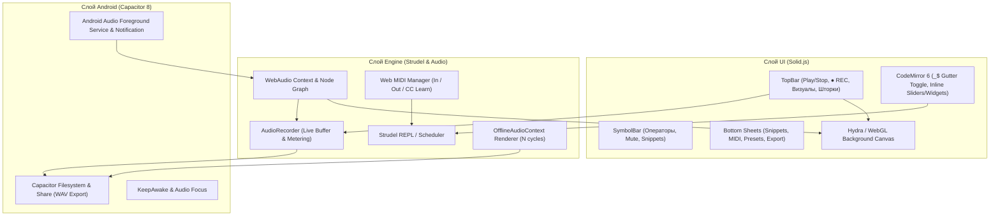

# Strum — Спецификация фазы Beta (v0.2.0-beta)

- **Дата:** 2026-11-16
- **Статус:** на утверждении
- **Лицензия проекта:** AGPL-3.0-or-later
- **Целевое устройство:** Google Pixel 9a (портрет 412×915 dp), minSdk 29 (Android 10), compileSdk 36, targetSdk 36
- **Порядок реализации:** 1 (WAV Запись/Баунс) → 3 (Hydra Визуалы) → 4 (Эргономика и _$ Mute) → 5 (Фоновый сервис) → 2 (MIDI Studio)

---

## 1. Обзор и цели этапа Beta

В версии `v0.1.3-alpha` был полностью реализован базовый функционал MVP (мобильный редактор CodeMirror 6, Strudel REPL, AST-модель и синхронизация визуальных контролов, локальные samplepack-банки, prebake-модули, шаблоны и темы).

Цель этапа **Beta (`v0.2.0-beta`)** — превратить Strum из легковесного блокнота-скетчпада в автономную **мобильную продакшн- и лайв-студию**, готовую к выступлениям, записи треков, управлению внешними синтезаторами и созданию мультимедийных аудиовизуальных сетов.

---

## 2. Архитектура и модули

---

## 3. Детальные подсистемы

### 3.1. Запись и экспорт звука (WAV) — Фаза 1

Подсистема записи решает две задачи: прямая запись живого джема и детерминированный баунс циклов паттерна.

1. **Живая запись (Live Recording):**
   - Кнопка `● REC` в верхней панели (`TopBar`).
   - При нажатии: статус переключается на мигающий красный индикатор `● 00:00`, подключается `AudioWorkletNode` (или легковесный `ScriptProcessorNode` / `MediaStreamAudioDestinationNode`) к выходу главного микса Strudel (`getAudioContext().destination`).
   - Кодирование в кольцевой PCM буфер. При остановке формируется 16-bit / 44.1kHz стерео PCM WAV файл.
   - Диалог завершения: предварительное прослушивание, размер файла, сохранение в IndexedDB и системный экспорт через `@capacitor/share` и Filesystem в папку `Music/Strum` или `Downloads`.
2. **Офлайн-баунс (Offline Bounce of $N$ Cycles):**
   - Модальное окно / шторка «Bounce to WAV»: выбор длительности в циклах (1, 2, 4, 8, 16, 32, 64) и темпа (CPS/BPM).
   - Запуск Strudel-паттерна в изолированном `OfflineAudioContext`: рендеринг быстрее реального времени без щелчков, задержек и артефактов буферизации мобильного CPU.
   - Генерация WAV с метаданными (название трека, дата, темп).
   - Индикатор прогресса в реальном времени (0% - 100%).

### 3.2. Интерактивные визуалы и сценический режим (Hydra) — Фаза 3

Гибридная визуальная система: встроенный WebGL холст с движком **Hydra-synth** + банк готовых аудиореактивных шейдер-пресетов.

1. **Архитектура визуального слоя:**
   - Полноэкранный `<canvas id="strum-visual-canvas">`, расположенный фоном под редактором.
   - Регулятор непрозрачности (Opacity Slider / кнопка режимов в TopBar):
     - `100% Code` — обычный вид редактора (визуал отключен для экономии батареи).
     - `Hybrid / Stage` — полупрозрачный редактор (30-50% темного фона), сквозь который просвечивают визуалы.
     - `100% Visuals` — сценический полноэкранный режим без кода (или с минимумом статусных индикаторов), управление жестами.
2. **Аудиореактивность (FFT & Hap Triggers):**
   - Анализатор `AnalyserNode` подключен к мастер-шине звука: снимает RMS, Sub/Bass (20-150Hz), Mid (150-2500Hz), High (2500-16000Hz).
   - Strudel Hap Events: перехват событий триггера паттернов (удары бочки, снейра, синтов) для импульсной модуляции параметров Hydra (`osc()`, `kaleid()`, `modulate()`, `color()`).
3. **Банк пресетов:**
   - Не менее 8 встроенных сценических пресетов (Neon Glitch, Cyber Tunnel, Audio Ripple, Feedback Void, VHS Synthwave, Kinetic Typo, Liquid Acid, Wireframe Grid).
   - Возможность писать live-код Hydra прямо в Strudel-скрипте через специальный блок `// @hydra` или вызов `visual(...)`.

### 3.3. Эргономика студии и производительность — Фаза 4

1. **Быстрый Mute/Solo через `_$` в редакторе:**
   - В Strudel добавление подчеркивания `_` перед вызовом (`_$:` или `_s(...)`) мьютит данный блок или паттерн.
   - Добавление в gutter редактора (слева от номеров строк) кликабельного индикатора `M` / `S` напротив каждого корневого блока `$:`:
     - Одиночный тап по gutter/индикатору: быстро переключает `$: ...` ⇄ `_$: ...` без перемещения курсора через `replaceLiteral` / AST-трансформацию.
     - Кнопка быстрого мьюта текущего блока в `SymbolBar` (`_$: toggle`).
2. **Отдельная шторка Snippets (Библиотека сниппетов):**
   - Быстрый доступ к готовым паттернам: Beats (Trap, House, Jungle, DNB, Techno), Basslines (Acid 303, Reese, Sub, Pluck), Chords/Melodies, Fills, Transitions.
   - Вкладка «Пользовательские сниппеты»: кнопка «Сохранить выделенный код как сниппет» с выбором имени и тега.
   - Вставка в 1 тап в позицию курсора с автоматическим отступом.
3. **Оптимизация памяти и сборка мусора аудио:**
   - Очистка отработавших AudioBufferSourceNode и WebAudio-нод при смене паттернов и вызове `hush()`.
   - Монитор производительности: легкий счетчик FPS и предупреждение о перегрузке аудио-буфера.

### 3.4. Фоновый аудио-сервис (Android Foreground Service) — Фаза 5

1. **Android Media Foreground Service:**
   - Нативный сервис Android с приоритетом `FOREGROUND_SERVICE_TYPE_MEDIA_PLAYBACK`.
   - Постоянное воспроизведение без заиканий при блокировке экрана или сворачивании приложения.
2. **Media Notification в системной шторке и экране блокировки:**
   - Уведомление с кнопками управления: `Play` / `Pause` / `Stop`.
   - Отображение названия активного проекта/трека.
   - Захват `AudioFocus` (приостановка при входящем звонке, возобновление после завершения).

### 3.5. Поддержка MIDI (MIDI Studio) — Фаза 2

1. **Web MIDI In & MIDI Learn:**
   - Запрос доступа `navigator.requestMIDIAccess({ sysex: false })`.
   - Сканирование подключенных USB/Bluetooth MIDI-контроллеров.
   - Режим **MIDI Learn**: нажимаем «Learn» на любом слайдере или числовом параметре в коде, крутим ручку на контроллере — параметр привязывается к соответствующему MIDI CC (Control Change) номеру и каналу.
   - При вращении ручки: значение обновляется в реальном времени в REPL и синхронно переписывает литерал в коде.
2. **Web MIDI Out:**
   - Вывод событий паттернов в аппаратные синтезаторы через стандартный синтаксис Strudel: `s("midi").note("c3 e3 g3").midiout("Port Name")`.
   - Селектор доступных портов в шторке MIDI.

---

## 4. План версионирования и релиза

- Бамп версии в `package.json`, `android/app/build.gradle` и `src/ui/TopBar.tsx`:
  - `version: "0.2.0-beta"`
  - `versionCode: 200`
- Полный прогон тестов: `npm run check` (typecheck + test + build).
- Сборка релизного APK: `cd android && ./gradlew assembleRelease`.
- Публикация GitHub Release `v0.2.0-beta`.
